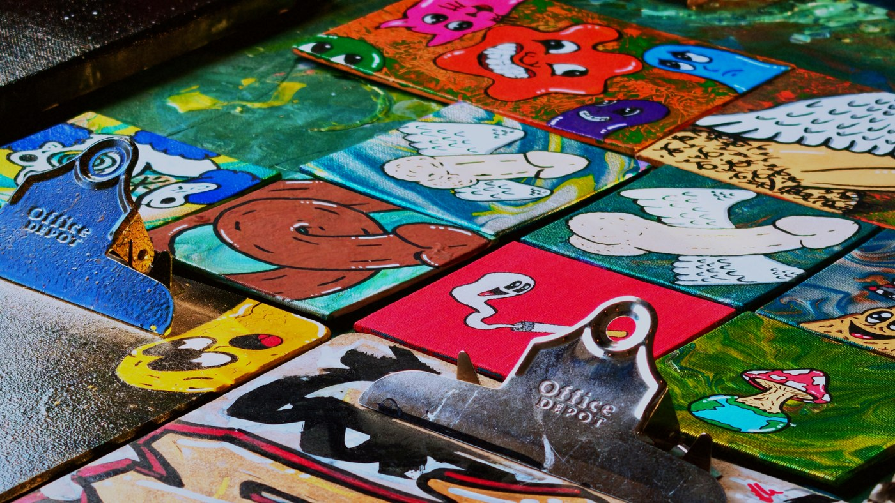

Rah Rah Room on a Sunday night. A vendor market, with hand painted skate decks and prints and earrings on folding tables. The usual Sunday craft fair setup. Except roughly one person in six is in full clown paint, and nobody's treating that as remarkable.

That ratio is the whole thing. A room full of clowns is a circus, and you already know how to feel about a circus. But a room where most people came in a t-shirt and a handful came in greasepaint is something else. It reads like a pep rally. Everybody's in on it, and nobody's performing at you.

## The market came first

Two hours of tables. Sticker sheets, decks painted edge to edge, jewelry hung off pegboard. A print booth run by somebody in full white face, who was also, clearly, just working their booth. People buying things, people not buying things, people leaning on the bar at the back.

The paint stops at the jaw on most of them. That's what it looks like when somebody did it themselves in a bathroom, instead of getting made up for a job.

## Then it turned into a show

At some point the tables came down. A banner went up across the back of the stage that read GO CLOWNS GO. The same crowd that had been shopping sat down to watch a comedy set. One person on a mic under a magenta wash, then two, then a bit that needed a lawn chair.

Later the whole cast came out and lined up across the stage. Nine people. Most in shorts and a shirt they already owned, one in full paint at the end of the row, everybody holding a drink. It's the single most accurate photo of the night. So it's at the top of this page.

## Then a band

Fog, a guitar, red on everything. The room went from seated to standing without anybody announcing it. This is the part where the night stops being a market and remembers it's a bar.

## Then somebody got body slammed

The patio out back had a mat on it, a referee in stripes with a red nose, a hand lettered sign, and two men wrestling in front of about 40 people standing in a ring around them. It went on for a while. There was a count. There was a celebration. Then there was more of it.

Nothing at the door suggested any of this was going to happen.

## Where it lives

40 frames from the night are up at full quality and free to download. Eight clips are up too, straight off the night, uncut. If you were there, you're probably in one of them.

Rah Rah Room. Sunday, August 30, 2026, seven in the evening until eleven. One camera, no flash, the room lit exactly the way the room lights itself.
