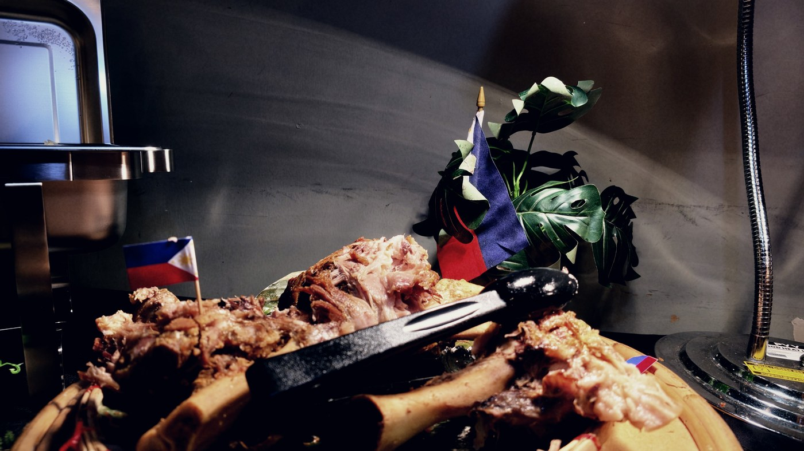
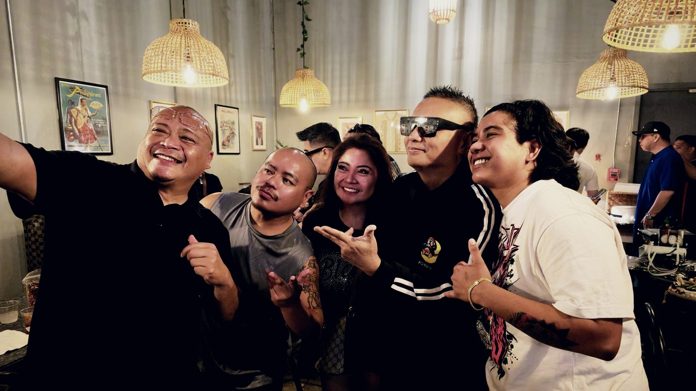

Andrew E. played Stable Hall on a Saturday night. First time he'd ever performed in Texas. The next afternoon he was on the South Side eating pancit off a buffet tray at Sari-Sari, and he sat down with us for ten questions while his crew ate around him.

He's thirty five years into this. In 1990 he put out Humanap Ka Ng Panget and dragged rap onto Philippine radio, which back then didn't have a word for what he was doing. Fourteen albums. Thirty five films. A label he started in 1997. He's a big part of why a Filipino rap record is a normal thing to own.

None of that's how the conversation started. It started with food.

## The only Bicolano who can't swim

His dad's from Bula, in Camarines Sur. The guy who founded the restaurant is from Naga, the next town over, which stops being a coincidence once you've been in enough Filipino rooms. He was born and raised in Parañaque on his mom's side, but the Bicol is in there, and so is the heat tolerance that comes with it.

> I am the only Bicolano who does not know how to swim

He was still laughing at himself when the next question landed. We asked what he eats first when he gets home. He didn't have to think. Pancit. He'd spotted it in the line the night before and gone back for it, and he said he spent the next day hoping there'd be more waiting for him. There was.

Then we asked if a dish only tastes right when a Filipino makes it far from home, and he refused the premise.

{poster=delicious.jpg}

## What San Antonio sounded like

We asked what the city sounded like the night before. He didn't hedge.

{poster=loudest.jpg}

The explanation was better than the compliment. Nobody in that room came to a concert, he said. They came to show love, and he gave it back. Thirty five years in, he knows the difference between an audience and a turnout.

He's also got a rule about touring that explains why he was in Texas at all. Wherever he goes, it has to be somewhere he hasn't been. He played Japan enough times that he started picking Taiwan instead, then Hong Kong. Same rule put him here.

{poster=handpick.jpg}

He could've gone to Houston. He could've gone to Dallas.

## The longing is the difference

The longest answer of the afternoon came when we asked how crowds out here compare to crowds back home. The energy's the same, he said. The longing isn't.

People here miss the Philippines whether there's a show or not, so when somebody comes over from Manila the missing gets louder, not quieter. Then he drew a line only somebody who's played to both would draw. The people in that room have their families with them while they work. Overseas workers who send everything home and live alone don't. That, he said, is what makes it sweeter here.

There was a nine year old at the show the night before who knew every word of a song he put out in 1991. He's still turning that one over.

## They will think you are a lunatic

Before any of it, he was DJing at Euphoria in 1988, making two thousand pesos a month. Ramon Jacinto's daughter was a regular. She heard him rap and told her dad there was somebody he should hear. Somebody came around for a demo tape. He handed it over and told them he was quitting anyway.

They signed him for a whole album.

{poster=euphoria.jpg}

Ask him who told him rapping in Tagalog wouldn't work and he corrects the question. Nobody had to. Rapping in English wouldn't have worked either, because rap didn't exist there yet. Not a genre, not a word anybody could define, nothing in the dictionary and nobody around to explain it.

{poster=lunatic.jpg}

A guy walking down the road talking to nobody, he said, and people would assume he needed a hospital. Then he made the whole country learn the word. He's still amused about it.

> Up until now they say I am crazy

## The last question

We asked what he tells the kids who watched him the night before and want to do what he does. He had this one loaded.

{poster=believe.jpg}

His reasoning, not ours: if the world can see you don't believe in yourself, the world's got no reason to believe in you either. Get that part right and the rest follows.

Then he asked if we wanted to keep going, said he'd be there till two in the morning, and recorded a thank you to San Antonio without anybody asking, because that was the part he actually cared about.

## Credits

Shot at Sari-Sari on the South Side, Sunday, August 30, 2026, the day after the Stable Hall show. Two cameras, no lights, the room exactly how it was. Andrew E. saw the cut before you did. House rule.
